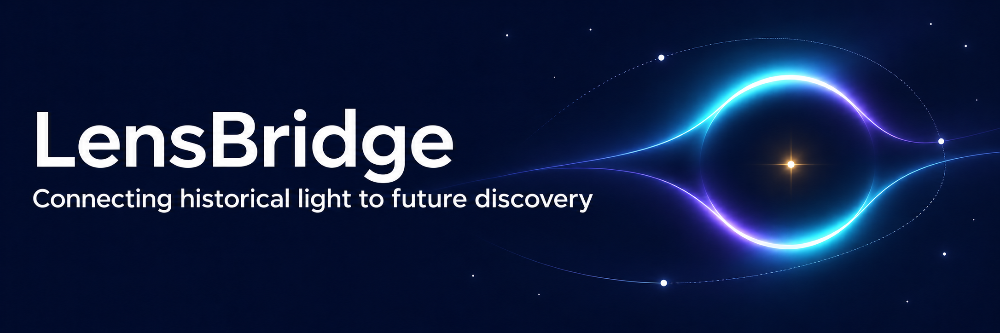

# LensBridge
## Connecting historical light to future discovery.

The Roman Microlensing Trifecta — a community research initiative for the Roman era.

**Project originated by Bart Salazar · Developed with Brad Devowe**

*Simple Minds Studios · Community contributors to Roman-era science infrastructure*

[Explore the project](https://simple-minds-studios.github.io/RomanMAST/) · [Run the public-data examples](examples/public_data/README.md)

## Executive Summary

The **Nancy Grace Roman Space Telescope** will transform time-domain astronomy in the Galactic bulge, enabling a large-scale census of isolated stellar remnants—including black holes, neutron stars, and free-floating planets—through microlensing and astrometric measurements.

This project argues that three carefully curated historical datasets, ingested into the **Mikulski Archive for Space Telescopes (MAST)**, could provide the temporal, astrometric, and parallax context Roman needs to convert detections into stronger physical measurements.

## The Proposed Trifecta

### 1. OGLE–Gaia Long-Timescale Microlensing Seed Catalog

Candidate identification and astrometric context for rare, long-duration events, including possible black-hole and neutron-star lenses.

### 2. Spitzer Microlens Parallax Catalog

Historical parallax measurements from a unique space-based observing geometry that can complement Roman astrometry.

### 3. OGLE–KMTNet Trifecta Light-Curve Catalog

Long-baseline and high-cadence light curves intended to improve temporal completeness and anomaly recovery.

## Why It Matters

Microlensing is fundamentally time-integrated. No single observation or archive contains every quantity needed to constrain lens mass, distance, and velocity. Connecting historical surveys with Roman-era observations could make archival data an active component of discovery rather than passive storage.

## Public data examples

Runnable [Python examples](examples/public_data/README.md) retrieve historical OGLE, KMTNet and Spitzer samples. The same-event mode records the documented OGLE-2016-BLG-1190 / KMT-2016-BLG-0113 association, explicit time offsets and source checksums. See the [source inventory](docs/RomanMAST_data_sources_2026-11-19.md) for data formats, provider policies and validation status.

The [three-observatory collection](datasets/events/OGLE-2016-BLG-1190/README.md) now reproduces **10,560 measurements** of that same event: OGLE (8,801), KMTNet (1,745) and the published Spitzer subset (14). Use `--trifecta` to retrieve the selected files and their provenance. Cross-calibration and physical fitting remain pending.

## Name and continuity

LensBridge is the project identity adopted on 19 November 2026. The existing `RomanMAST` repository URL, historical documents and command names remain available for continuity. This name does not imply affiliation with Roman or MAST.

## Project Status

This repository presents a **community-authored research concept and infrastructure proposal**. It is not an official NASA, STScI, MAST, Roman mission, OGLE, KMTNet, Gaia, or Spitzer publication, endorsement, or data release.

Scientific claims, estimates, and proposed workflows should be independently reviewed and validated before research or operational use.

## Rights and Use

The root [LICENSE](LICENSE) includes MIT and CC BY 4.0 terms, with copyright credited to Bart Salazar and Brad Devowe. Apply the appropriate license to the material used and preserve its required notices and attribution. Earlier grants, third-party licenses, and legal exceptions remain in effect. Conflicting generic repository-standard notices do not narrow those permissions.

See [Rights and Attribution](RIGHTS_AND_ATTRIBUTION.md) for licensing scope and preferred credit for adaptations. Preferred public credit adds no restriction to MIT; Creative Commons material retains the attribution and other requirements of its applicable license.

## Attribution

Project concept originated by Bart Salazar, with development contributions from Brad Devowe. Published through Simple Minds Studios. Existing authorship and license notices remain applicable.
