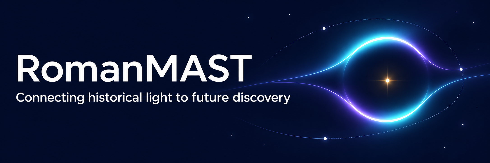

# RomanMAST

Connecting historical light to future discovery.

[Open the project homepage](../) or [explore the public-data tools](https://github.com/Simple-Minds-Studios/RomanMAST/tree/main/examples/public_data).

This independent community project develops historical microlensing context for future Roman science. The repository now includes runnable retrieval and integrity checks; calibration and physical model fitting remain future work.

Created by Bart Salazar and Brad Devowe. Not an official mission or archive release.
